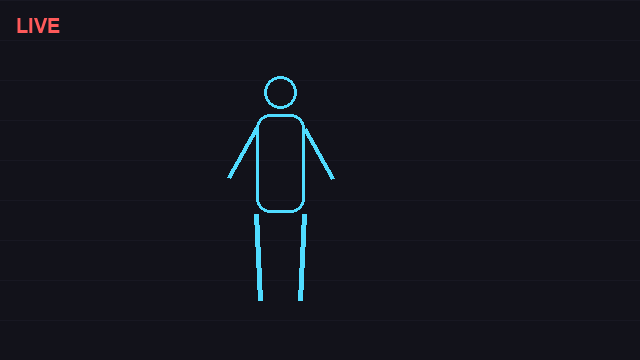

# atomic-snap-vanish

I saw that viral reel of a guy vanishing out of his meetings (@Nicovic17's [vanish_webcam](https://github.com/Nicovic17/vanish_webcam)) and thought: neat, but the room just... goes empty? Too polite. I wanted the meeting to *know* something happened.

So this one works differently: you **snap your fingers**. Your body blows apart into glowing particles, they collapse into a blackhole vortex, and then your own atoms spell out your excuse — `BRB...`, `GONE`, `MY INTERNET DIED` — before crumbling into dust. Then the room is empty. You were never there; only the message remained.

## ✨ Preview



*Rendered preview of the effect sequence (snap → dissolve → vortex → excuse → dust). The real thing runs live on your webcam, driven by your actual hand — MediaPipe tracks the snap.*

Credit where it's due — the idea sparked from Nicovic17's repo. This is a from-scratch rebuild (no shared code) with a snap gesture instead of the peace sign, and a particle-to-text morph I haven't seen in any of the webcam-vanish projects out there.

## How to play

Step out of frame for 3 seconds so it grabs your empty-room background. Pinch your **thumb and middle finger** together — a golden aura shows up. Snap them apart. Watch the sequence. Show a **✌️ peace sign** when you want back in (sparks fly in from the screen edges and rebuild you, there's a chime and everything).

Install:

```bash
git clone https://github.com/turfin-logic/atomic-snap-vanish.git
cd atomic-snap-vanish
pip install -r requirements.txt
python snap_vanish.py
```

On Windows: `setup.bat` once, then `run.bat` every time.

## The small stuff

- The void message cycles with `T` — BRB / GONE / AFK / MY INTERNET DIED / IN A MEETING
- `E` toggles Ghost Echo: after you vanish, a flickering spectral replay of your last 2.5 seconds haunts the room. Deeply unnecessary. Keeping it.
- `M` toggles a sparkle trail on your index fingertip
- `P` saves a photo into `saves/`, `B` re-captures the background, `C` switches cameras (it reads device names, so it skips phone/virtual cams like Iriun automatically), `Q` quits
- Snap gesture is pinch thumb+middle, then release fast — same muscle motion as a real snap, so it triggers naturally

## Zoom / Meet / Teams

The app streams into a virtual camera, so in your meeting app just pick **OBS Virtual Camera** as your webcam. You need OBS installed once (`winget install OBSProject.OBSStudio`) — you never have to open OBS itself. The app finds the virtual cam automatically on startup.

## Notes

- Python, OpenCV, MediaPipe, NumPy, Pygame, pyvirtualcam. Everything stays on your machine — nothing is recorded or uploaded.
- Black camera frame? HP laptops hide the lens behind a privacy slider, and some have a camera kill-switch key (F2/F8). The app keeps rescanning and connects the moment a real image shows up.
- MIT licensed. If you build something on top of it, a link back is appreciated but not required.

Inspired by [Nicovic17/vanish_webcam](https://github.com/Nicovic17/vanish_webcam) — go star that one too.
